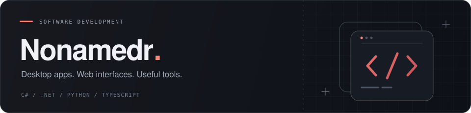

  <picture>
    <source media="(prefers-color-scheme: light)"
      srcset="https://raw.githubusercontent.com/Undddg/Undddg/8c7f350c946f41b46ed6bcaa3d78136e487124b1/assets/profile-header-light.svg" />
    
  </picture>

  Desktop applications, web interfaces, and backend services. 
  Working with C#, .NET, Avalonia UI, Python, and TypeScript.

 

<h3 align="center">My toolkit</h3>

LANGUAGES

  <a href="https://skillicons.dev"><picture><source media="(prefers-color-scheme: light)" srcset="https://skillicons.dev/icons?i=cs,python,ts,js&theme=light" /></picture></a>

DESKTOP

  <a href="https://skillicons.dev"><picture><source media="(prefers-color-scheme: light)" srcset="https://skillicons.dev/icons?i=dotnet&theme=light" /></picture></a>
  <picture><source media="(prefers-color-scheme: light)" srcset="./assets/avalonia-ui-light.svg" /></picture>

WEB & DATA

  <a href="https://skillicons.dev"><picture><source media="(prefers-color-scheme: light)" srcset="https://skillicons.dev/icons?i=django,fastapi,vue,vite,html,css,sqlite&theme=light" /></picture></a>

TOOLS & DEPLOYMENT

  <a href="https://skillicons.dev"><picture><source media="(prefers-color-scheme: light)" srcset="https://skillicons.dev/icons?i=git,github,githubactions,docker,linux&theme=light" /></picture></a>

 

---

### What I build

- **Desktop applications** with C#, .NET, and Avalonia UI.
- **Web applications** with Vue and TypeScript, backed by Django and FastAPI.
- **Automation and tools** that simplify everyday workflows.

 

### What I care about

- **Useful software.** Tools that solve problems I actually encounter.
- **Clear interfaces.** Fewer distractions, obvious actions, visible progress.
- **Learning by building.** Turning ideas into working features and improving them through use.

---

Build something useful. Make it better. Repeat.

